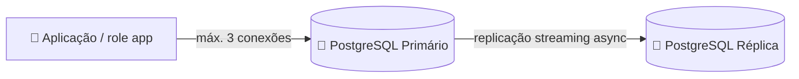

# 🛡️ Simulação de DDoS: Esgotamento de Conexões com PostgreSQL/Docker/DBeaver


## 📑 Sumário

1. [Identificação](#1--identificação)
2. [Resumo do incidente](#2--resumo-do-incidente)
3. [Linha do tempo](#3--linha-do-tempo)
4. [Medições](#4--medições)
5. [Causa raiz](#5--causa-raiz)
6. [Correção aplicada](#6--correção-aplicada-e-a-prova-de-que-funcionou-antes-e-depois)
7. [Comparação com serviço gerenciado](#7--comparação-com-serviço-gerenciado)
8. [Prevenção e lições](#8--prevenção-e-lições)
9. [Respostas às perguntas do cenário](#9--respostas-às-perguntas-do-cenário)

---

## 1. 🧾 Identificação
**Nomes, cenário, caminho usado (Docker ou instalado).**

O projeto ao qual o presente README diz respeito simula um cenário de esgotamento de conexões e negação de serviço, comum em ataques de DDoS (Distributed Denial of Service), realizado em um ambiente local.

> 💡 De forma simples, um ataque DDoS pode ser definido como a sobrecarga de um servidor ou banco de dados através de um volume massivo de requisições simultâneas, geralmente partindo de uma botnet (rede de computadores 'zumbis' infectados por malware e controlados remotamente). O resultado disso é a degradação ou indisponibilidade do serviço para usuários reais.

### 🐳 Montagem do ambiente

No que diz respeito à montagem do ambiente, utilizando Docker foram criados dois bancos de dados PostgreSQL: um primário (produção) e uma réplica, com ambos contendo dados fictícios de clientes, como se em uma aplicação de e-commerce ou varejo. Esses bancos foram criados usando o arquivo `docker-compose.yml` em anexo.



### ✅ Verificação da replicação

É possível ainda verificar o status de replicação entre os dois ao rodar o comando `SELECT pg_is_in_recovery()` na réplica e receber `TRUE`, assim como o comando `SELECT client_addr, state, sync_state FROM pg_stat_replication` no primário e receber `streaming` e `async`.

```sql
-- Na réplica (esperado: TRUE)
SELECT pg_is_in_recovery();

-- No primário (esperado: streaming | async)
SELECT client_addr, state, sync_state FROM pg_stat_replication;
```

### 📥 Carga de dados e limite de conexões

Foram então inseridas 1000 linhas de dados no banco primário, que por sua vez as replica.
No projeto, o banco foi configurado para conter um limite de somente até três conexões para uma role chamada ‘app’ utilizando o comando:

```sql
CREATE ROLE app LOGIN PASSWORD 'app' CONNECTION LIMIT 3;
```

### 💥 Simulação do ataque

Posteriormente, ao abrir três terminais e rodar o comando:

```bash
docker compose exec primary psql -U app -d postgres -c "SELECT pg_sleep(300);"
```

criamos três conexões a esse banco, que foram verificadas no DBeaver. 

Podemos fazer uma checagem do status de cada uma dessas conexões ao rodar a seguinte query:

```sql
SELECT pid, usename, state, now() - query_start AS tempo
FROM pg_stat_activity WHERE usename = 'app';
```

Em que:

- 🔢 `pid` é o ID de cada conexão;
- 👤 `usename` é a role da conexão, aqui filtrada para somente `'app'`;
- 🚦 `state` é o status atual, podendo ser `active` (executando) ou `idle` (inativa)
- ⏱️ `now() - query_start AS tempo` como um cálculo rápido entre o momento atual e o início das queries iniciadas pelas conexões

Ao rodar isso, recebemos uma tabela mostrando as três conexões, cada uma representada por uma linha, com `state = active` e `tempo` crescendo até 5 minutos, provando o esgotamento do limite de conexões.

Ao tentar uma quarta conexão, recebemos o erro:

```text
psql: error: connection to server on socket "/var/run/postgresql/.s.PGSQL.5432" failed: FATAL:  too many connections for role "app"
```

comprovando que o banco não aceita mais conexões para essa role e, portanto, está fora do ar.

<!-- 📸 Sugestão: adicione aqui um print do DBeaver mostrando as 3 conexões ativas -->
<!--  -->

---

## 2. 📝 Resumo do incidente

Durante uma simulação de ataque DDoS, o banco de dados ficou indisponível para a aplicação às 13:22, depois que um grande volume de conexões demoradas ocupou todas as vagas disponíveis. Novas tentativas de acesso foram recusadas, embora o banco continuasse em funcionamento. Foram aplicadas regras para encerrar automaticamente conexões que demoram demais, e o serviço voltou ao normal às 13:24. A verificação posterior confirmou que todos os dados permaneceram intactos.

---

## 3. Linha do tempo do incidente

- **Entre 38s a 26s antes*: conexões da role `app` iniciadas com `pg_sleep(300)`, esgotando o `CONNECTION LIMIT 3`.
- **13:22 (T0)**: erro no terminal ao tentar conectar; banco indisponível para a aplicação.
- **13:22 a 13:24**: execução dos comandos `ALTER ROLE app SET statement_timeout` e `idle_session_timeout`.
- **13:22 a 13:24**: nova tentativa de conexão com `pg_sleep(300)` encerrada pelo `statement_timeout`.
- **13:24**: serviço restabelecido; DBeaver mostra a tabela de conexões vazia.
- **13:39**: `SELECT COUNT(*)` retorna 1000 clientes, confirmando que nenhum dado foi perdido.
  
---

## 4. 📊 Medições

| Métrica | Valor | Cálculo |
|---|---|---|
| **RTO** | 2 minutos | 13:24(T1) − 13:22(T0) |
| **RPO** | 0 (nenhum dado perdido) | `COUNT(*)` = 1000 clientes após a recuperação |

- **13:22 (T0):** momento em que o erro apareceu no terminal, marcando o início da indisponibilidade da role `app`.
- **13:24 (T1):** momento em que a tabela de conexões apareceu vazia no DBeaver, marcando o fim da indisponibilidade (serviço restabelecido).

---

## 5. 🔍 Causa raiz

A causa raiz é o esgotamento do limite de conexões da role `app` (`CONNECTION LIMIT 3`).

Sessões longas, como o `pg_sleep(300)`, ocupam todos os slots, e sem timeouts configurados (`statement_timeout` e `idle_session_timeout` em 0) nada as encerra.
Com isso, novas conexões da app eram rejeitadas, tornando a aplicação indisponível mesmo com o banco em funcionamento.

---

## 6. 🔧 Correção aplicada e a prova de que funcionou (antes e depois)

Após o banco se provar indisponível, vide a mensagem de erro que constou no Powershell, rodamos o comando a seguir:

```sql
ALTER ROLE app SET statement_timeout = '3s';
ALTER ROLE app SET idle_session_timeout = '5s';
```

> ⚠️ É importante mencionar que Roles em PostgreSQL por padrão não contém nenhum tempo de timeout relativo ao tempo de um comando SQL (`statement_timeout`) nem de sessão inativa (`idle_session_timeout`).

Para liberar o banco de imediato, as sessões existentes foram encerradas manualmente:

```sql
SELECT pg_terminate_backend(pid)
FROM pg_stat_activity
WHERE usename = 'app';
```

O `pg_terminate_backend` finaliza o processo de cada sessão da role `app`, derrubando a conexão e liberando o slot. Com isso, o banco voltou a ficar sem conexões e, portanto, disponível.

Temos a prova que essa solução funcionou ao tentarmos uma nova conexão de 500s e recebermos `canceling statement due to statement timeout`, e ao verificarmos a ausência de conexões no banco.

| Estado | Resultado |
|:-------|:----------|
| ❌ Antes | `FATAL: too many connections for role "app"` |
| ✅ Depois | `canceling statement due to statement timeout` e nenhuma conexão ativa |

---

## 7. ☁️ Comparação com serviço gerenciado
**Como Multi-AZ, PITR ou outro recurso trataria o caso.**

É possível afirmar que uma variedade de serviços tanto relativos a Banco de Dados quanto Networking oferecidos por CSPs (Cloud Service Providers) contam com funcionalidades de proteção e mitigação contra ataques DDoS. Utilizando a AWS (Amazon Web Services) como exemplo, essa proteção é feita em camadas combinando serviços diversos que trabalham juntos para filtrar tráfego malicioso.

### 🛑 AWS

Entre esses serviços, é possível mencionar as capacidades do **AWS Shield Standard**, já implantado por padrão em serviços como Amazon CloudFront e Route 53. Para cenários mais críticos, existe ainda o **AWS Shield Advanced** que adiciona detecção e mitigação mais robustas, além de diagnóstico detalhado e capacidades de aprendizado de máquina.

### 🐘 PostgreSQL local vs. Amazon RDS

Comparando diretamente as opções de rodar um PostgreSQL local ou utilizar um serviço de banco de dados gerenciado como o Amazon RDS, no segundo caso o banco de dados fica em uma rede privada gerenciada pelo provedor de nuvem.

### 🌍 Multi-AZ

O **Multi-AZ** (Multi Availability Zones) mantém uma cópia do banco em outra zona de disponibilidade, assumindo automaticamente em caso de falha da instância principal, seja qual for o motivo. Isso é mais robusto do que ter dois bancos locais no mesmo servidor, como foi feito no projeto, pois ambos continuam dependendo da mesma máquina física, e reduzem o tempo fora do ar.

### ⏪ PITR

Já o **PITR** (Point-in-Time Recovery) permite restaurar o banco para um momento anterior ao ataque, em caso de dados corrompidos ou apagados. Localmente, esse recurso precisaria ser montado por conta própria, enquanto que na nuvem, ele já vem configurado por padrão ou é bem mais fácil de habilitar através de backups automáticos e snapshots.’

---

## 8. 🚧 Prevenção e lições

**Prevenção:** é recomendável manter timeouts (`statement_timeout` e `idle_session_timeout`) configurados desde o início, usar um pool de conexões como o PgBouncer e monitorar o uso de conexões por role com alertas antes de atingir o limite.

**Lições:** o incidente mostrou a necessidade de um failover: o ambiente tinha apenas um banco principal e sua réplica, sem nenhum mecanismo que promovesse outro banco para assumir o papel do principal caso ele falhasse. Nesse sentido, o uso de bancos de dados fornecidos por cloud providers é mais interessante.

```sql
-- Monitoramento: conexões ativas por role
SELECT usename, state, count(*)
FROM pg_stat_activity
GROUP BY usename, state;

## 9. ❓ Respostas às perguntas do cenário

O cenário fornecido pelo material contou com as seguintes perguntas:

### 1️⃣ O que aconteceu com as transações que a aplicação tentou fazer durante o ataque?

Considerando que o PostgreSQL é compliant com o conjunto de propriedades ACID (Atomicidade, Consistência, Isolamento e Durabilidade) desde 2001, isso quer dizer que as transações que já estavam em andamento porque o usuário já tava logado irão continuar normalmente, mesmo que ela fique mais lenta. Visto que o limite estabelecido só barra novas conexões mas não derruba as existentes, transações que tentaram iniciar uma nova conexão após esse limite ser esgotado nunca sequer chegam a começar e o destino delas depende de outros detalhes da aplicação, como serviço de fila ou retry.

### 2️⃣ Por que limitar conexões por usuário e não só o limite global? Que papel teria um pool/proxy (RDS Proxy, PgBouncer)?

Porque o limite global é compartilhado entre roles, de forma que se uma única role esgota o `max_connections`, todas as outras ficam sem conexão e/ou têm a performance afetada. Já limitar as conexões por role isola a desconexão a um único tipo de role e permite dividir essa capacidade total entre todas elas.

Com relação ao PgBouncer e RDS Proxy, vamos primeiro analisar cada um:

- 🔁 O **pgBouncer** é um gerenciador de pool de conexões para PostgreSQL, reaproveitando conexões em vez de abrir uma nova a cada requisição.
- ☁️ O **Amazon RDS Proxy** é um serviço de proxy para banco de dados totalmente gerenciado pela AWS que atua como intermediário entre aplicações e bancos de dados instalados via Amazon RDS ou Aurora.

Resumindo, ambos são serviços que se posicionam entre uma aplicação e um banco de dados reaproveitando conexões. A diferença é que o pgBouncer é gratuito e open-source mas totalmente gerenciado pelo administrador do banco de dados e voltado ao PostgreSQL, enquanto que o RDS Proxy é gerenciado pela Amazon e é compatível somente com RDS e Aurora.
Esses serviços agem protegendo o `max_connections` definido do banco, além de imporem outras funcionalidades como máximo de conexões próprias, timeouts e filas.
